<div align="center">

# Metal Vibe Tracer

**A spectral GPU path tracer for macOS, built with Swift and Metal.**<br>
Real-time ReSTIR, OpenPBR materials, OpenUSD import, and denoised exports.

   

</div>

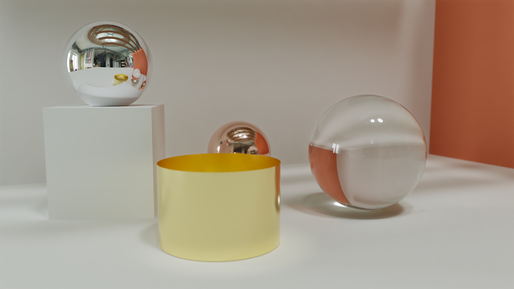

<p align="center"><sub>The built-in Pavilion scene lit by an HDRI environment, with spectral transport and a thin-lens camera. 1024 spp, denoised with Open Image Denoise.</sub></p>

## Highlights

- 🔬 **Recent research, implemented and cited.** ReSTIR DI, GI and PT, plus 2025–2026 papers on spatial reuse, reservoir splatting and control variates. [REFERENCES.md](REFERENCES.md) maps every method to the code that implements it.
- 🌈 **Spectral light transport.** Four wavelengths per path, CIE illuminants, dispersion and thin-film interference, through every ReSTIR mode.
- 📏 **Defaults chosen by measurement.** A new method becomes the default only where it wins at equal render time. The figures are in [tests/PERFORMANCE.md](tests/PERFORMANCE.md).
- 🧪 **Tested on the GPU.** The verification suite runs the production shaders and render path on Metal (189 checks passed on 2026-10-23, Apple M4).
- 🎬 **Production formats.** OpenPBR surfaces, MaterialX graphs, OpenUSD scenes, OBJ/MTL, and OpenEXR export.
- 🏛️ **Production-scale scenes.** San Miguel (10 M triangles, 287 materials) and the Amazon Lumberyard Bistro import and render, with alpha cutouts, glass and anisotropic texture filtering.
- ✅ **Validated against Mitsuba 3.** Built-in scenes agree within 0.1% of mean radiance, and five of seven Bitterli scenes within 2.5% (see [Validation](#validation)).

## Production scenes

<table>
  <tr>
    <td width="50%">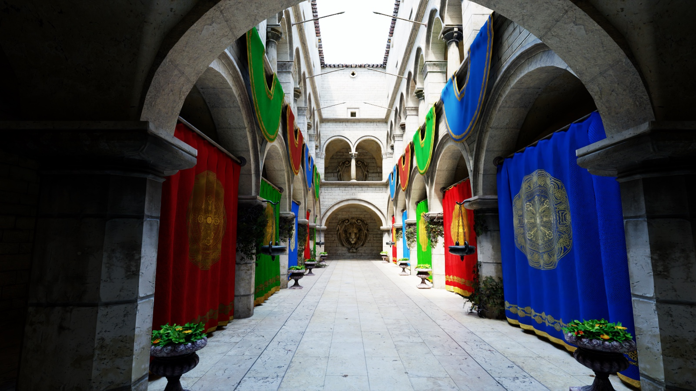</td>
    <td width="50%">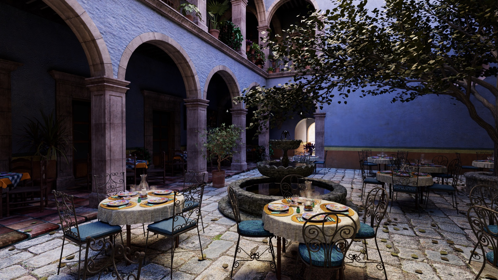</td>
  </tr>
  <tr>
    <td align="center"><sub><b>Crytek Sponza</b> at noon. 262 k triangles, 25 materials.</sub></td>
    <td align="center"><sub><b>San Miguel</b> at golden hour. 10.0 M triangles, 287 materials, imported from OBJ in 12 s; glassware rendered as glass.</sub></td>
  </tr>
  <tr>
    <td width="50%">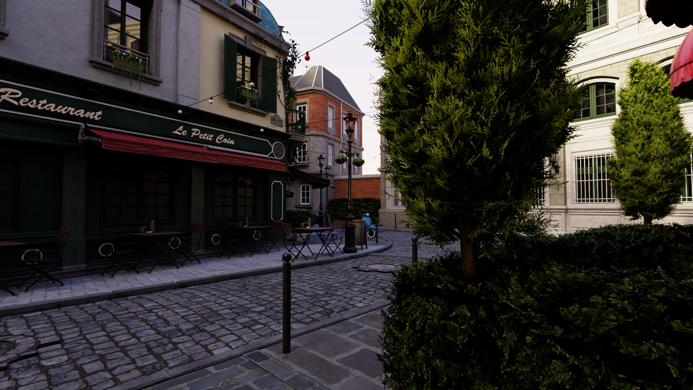</td>
    <td width="50%">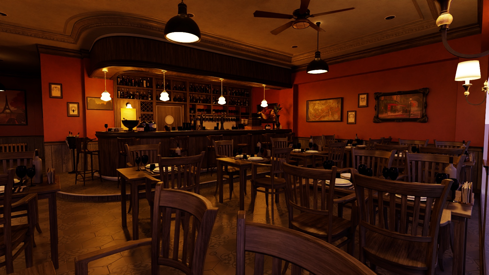</td>
  </tr>
  <tr>
    <td align="center"><sub><b>Bistro exterior.</b> 2.8 M triangles, 132 materials, 940 Mpixel of textures fitted to the GPU budget, thin-walled glass windows.</sub></td>
    <td align="center"><sub><b>Bistro interior</b> in the evening. 1.0 M triangles, lit by its own lamps with an incandescent (CIE A) spectrum, glass bottles and cabinets.</sub></td>
  </tr>
</table>

<p align="center"><sub>Imported from Morgan McGuire's Computer Graphics Archive (OBJ with MTL materials translated to OpenPBR MaterialX), 1600×900, 128 spp, denoised with Open Image Denoise, on a 16 GB Apple M4. The daylight Bistro exterior has the scene's lamps and emissive signs switched off; the evening interior brightens its lamps 60×.</sub></p>

## Gallery

<table>
  <tr>
    <td width="50%">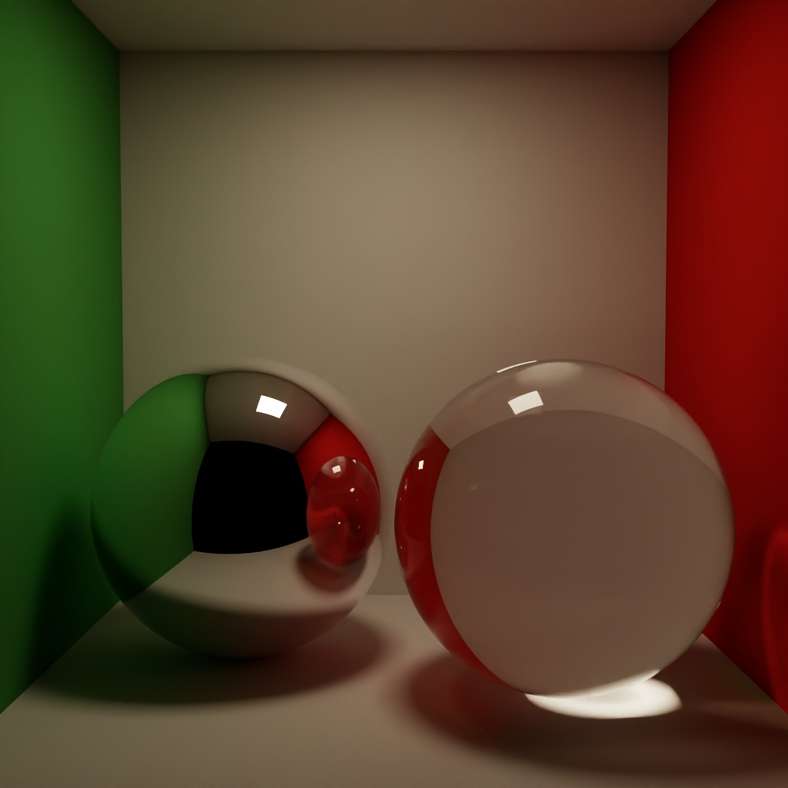</td>
    <td width="50%">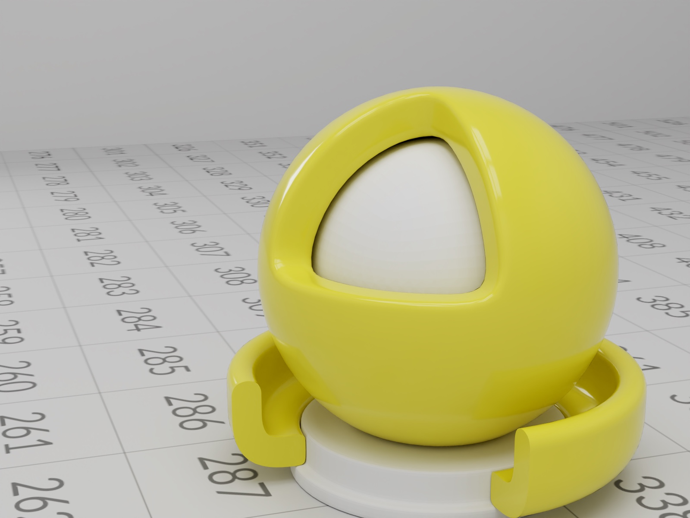</td>
  </tr>
  <tr>
    <td align="center"><sub><b>Caustics and interreflection.</b> A glass sphere focuses the area light onto the floor.</sub></td>
    <td align="center"><sub><b>OpenUSD import.</b> The ASWF Standard Shader Ball, with its materials mapped to OpenPBR.</sub></td>
  </tr>
</table>

<table>
  <tr>
    <td width="33%">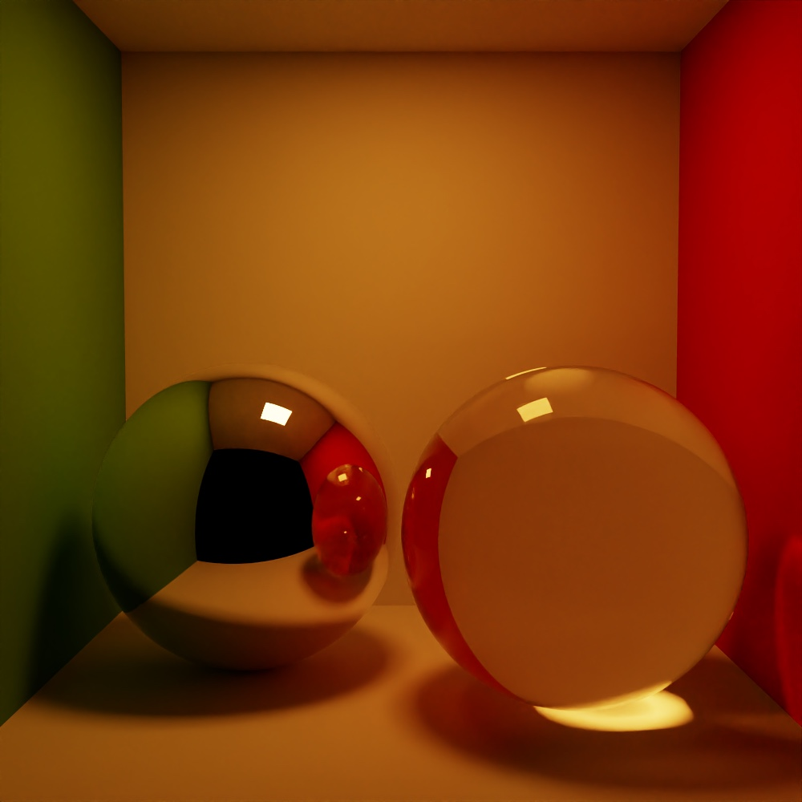</td>
    <td width="33%">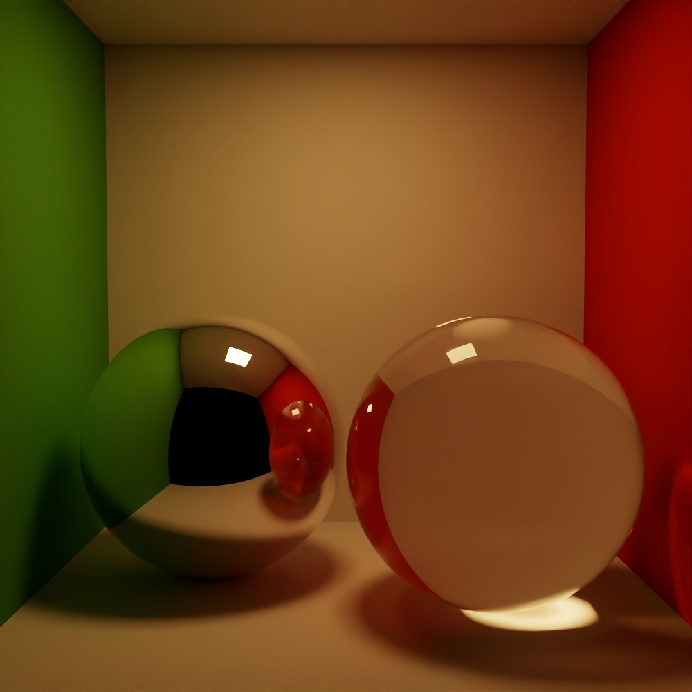</td>
    <td width="33%">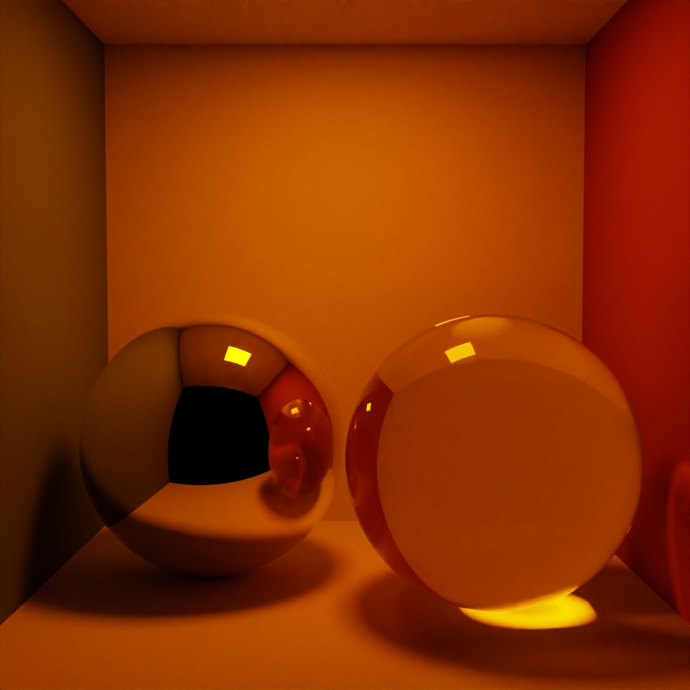</td>
  </tr>
  <tr>
    <td align="center"><sub><b>Incandescent</b> (CIE A)</sub></td>
    <td align="center"><sub><b>Fluorescent</b> (CIE FL11)</sub></td>
    <td align="center"><sub><b>Sodium</b> (CIE HP1)</sub></td>
  </tr>
</table>

<p align="center"><sub><b>Spectral illuminants.</b> The same box under three <b>Light spectrum</b> presets. Sodium light has almost no green in its spectrum, so the green wall goes nearly black. RGB transport ignores these presets.</sub></p>

<table>
  <tr>
    <td width="50%">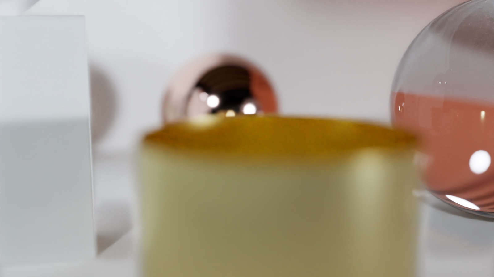</td>
    <td width="50%">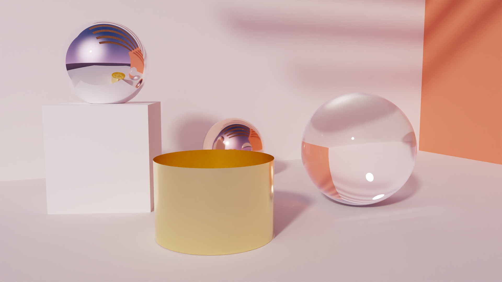</td>
  </tr>
  <tr>
    <td align="center"><sub><b>Thin-lens depth of field.</b> Focus on the copper sphere, with the gold cylinder in front out of focus.</sub></td>
    <td align="center"><sub><b>Procedural sky.</b> The roof beams against the Twilight preset, casting shadows on the orange wall.</sub></td>
  </tr>
</table>

<sub>Every image was rendered through the app's own export path with `python3 scripts/render_showcase.py` (shots in [`scripts/showcase.json`](scripts/showcase.json)). The environments are Poly Haven HDRIs (CC0). The Shader Ball render is an adapted work of the [ASWF Standard Shader Ball](https://github.com/usd-wg/assets/tree/3b75c2dad6a494897557dcca0098257bcf42a8c6/full_assets/StandardShaderBall) by the ASWF USD Working Group (geometry and textures by Chris Rydalch), [CC-BY-4.0](https://creativecommons.org/licenses/by/4.0/). The changes are listed in [docs/images/README.md](docs/images/README.md). The production scenes are from Morgan McGuire's [Computer Graphics Archive](https://casual-effects.com/data/): Crytek Sponza © 2010 Frank Meinl, Crytek ([CC BY 3.0](https://creativecommons.org/licenses/by/3.0/)); San Miguel © Guillermo M. Leal Llaguno ([CC BY 3.0](https://creativecommons.org/licenses/by/3.0/)); Amazon Lumberyard Bistro © 2017 Amazon Lumberyard ([CC BY 4.0](https://creativecommons.org/licenses/by/4.0/)). The Contemporary Bathroom is by Mareck, from Benedikt Bitterli's [rendering resources](https://benedikt-bitterli.me/resources/) (CC0).</sub>

## Validation

Every reference scene is rendered by both Metal Vibe Tracer and [Mitsuba 3](https://github.com/mitsuba-renderer/mitsuba3) from the same description, and the mean radiance is compared (`scripts/compare_mitsuba.py`, `scripts/compare_scene.py`).

<p align="center">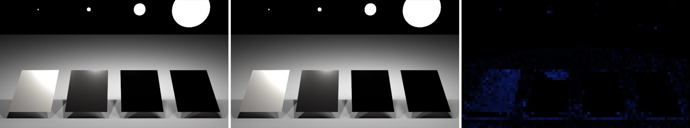</p>
<p align="center"><sub><b>Veach MIS</b>, Metal Vibe Tracer | Mitsuba 3 | relative difference. Mean radiance agrees within 0.11%, the Cornell box within 0.02%.</sub></p>

<p align="center">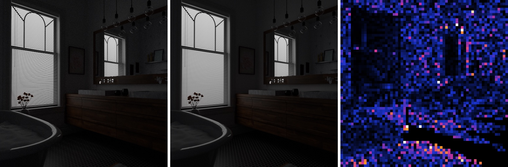</p>
<p align="center"><sub><b>Contemporary Bathroom</b> (Bitterli's rendering resources, converted to OpenUSD), Metal Vibe Tracer | Mitsuba 3 | relative difference: within 0.1%. Five of seven Bitterli scenes agree within 2.5%; the remaining gaps are documented model differences, such as OpenPBR's energy-conserving rough metals (<a href="REFERENCES.md">REFERENCES.md</a>, <code>BITTERLI2016</code>).</sub></p>

### Recent improvements

<p align="center">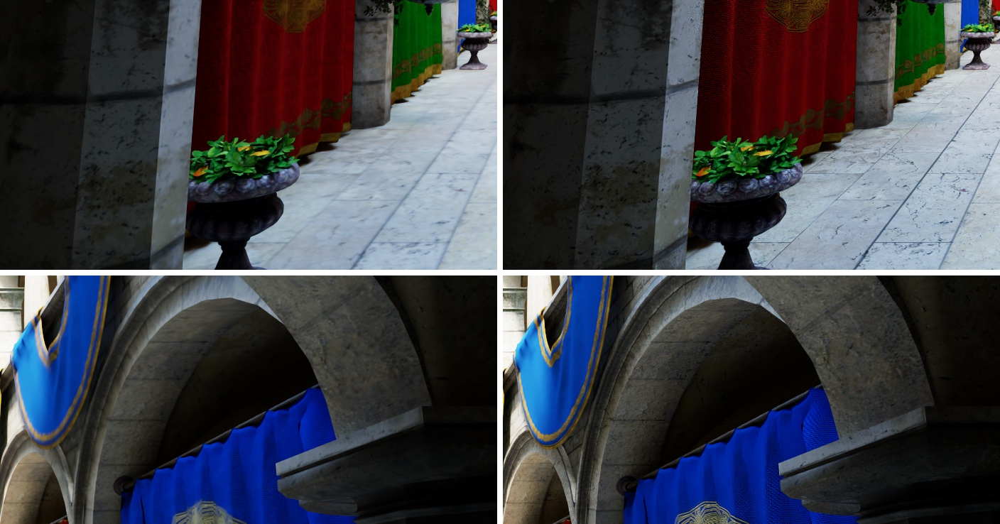</p>
<p align="center"><sub><b>Anisotropic ray-cone texture filtering</b> (before | after). Footprints are ellipses fed to the hardware's anisotropic filter (Akenine-Möller et al., JCGT 2021), and the camera footprint shrinks with the sample count as in pbrt-v4, so receding floors, fabric and stone stay sharp.</sub></p>

<p align="center">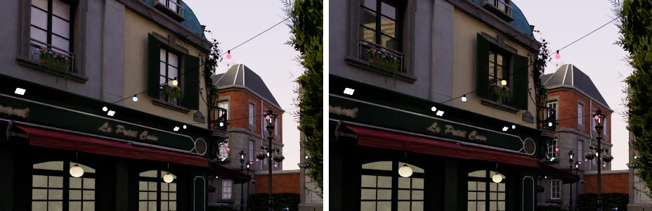</p>
<p align="center"><sub><b>MTL glass as thin-walled OpenPBR transmission</b> (before | after). Glass illumination models, and glass written as constant dissolve, now transmit light filtered by <code>Tf</code>; panes with <code>Ni 1</code> ("light does not bend") are thin-walled.</sub></p>

<p align="center">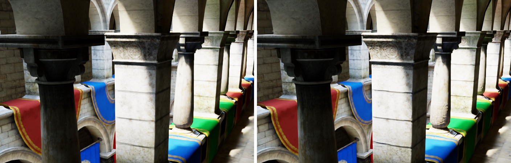</p>
<p align="center"><sub><b>Calibrated bump mapping</b> (before | after). MTL height maps are converted to normal maps at a strength calibrated on the archive's authored normal maps.</sub></p>

## Features

| | |
| --- | --- |
| **Path tracing** | ReSTIR DI with first-bounce ReSTIR GI on procedural scenes, and ReSTIR PT for imported scenes. Standard MIS, light-only and BSDF-only modes for comparison. |
| **Light transport** | Spectral (default) or RGB. CIE illuminant presets, dispersion, and thin film. |
| **Materials** | OpenPBR surfaces, image textures with anisotropic filtering, normal and bump maps, alpha cutouts, thin-walled glass, and a subset of MaterialX graphs. |
| **Scenes** | Six procedural test scenes, OBJ import with MTL materials, and OpenUSD import with hierarchy, instances, materials, lights and cameras. Scene size is limited by the Mac's GPU memory, not fixed caps. |
| **Acceleration** | Two-level instancing on Metal hardware ray tracing, with an exact software 4-wide BVH as a fallback. |
| **Camera and lighting** | Thin-lens depth of field, procedural skies, HDRI environments, and editable area lights. |
| **Denoising** | MetalFX for the interactive preview, and Open Image Denoise for snapshots and exports. |
| **Viewport** | Beauty, albedo, world normals, depth, and material/roughness views. |
| **Projects** | Portable `.vtrace` files with embedded assets, saved camera views, undo/redo, and autosave recovery. |
| **Export** | sRGB PNG and linear HDR OpenEXR (32-bit float) at independent resolutions and sample counts. |

<details>
<summary><b>Technical details</b></summary>

- **Path tracing:** ReSTIR with Standard MIS, light-only, and BSDF-only comparison modes. Imported scenes use ReSTIR PT, which reuses whole paths, including glossy, mirror and glass paths, with the improvements of ReSTIR PT Enhanced (Lin et al., SIGGRAPH 2022 and I3D 2026; `RESTIRPT2022`, `RESTIRPTE2026` in [REFERENCES.md](REFERENCES.md)). The procedural scenes use ReSTIR direct lighting with first-bounce diffuse ReSTIR GI, which is faster there; its spatial reuse can pick neighbours by compatibility-guided selection (Junkins et al., HPG 2026; `COMPATRESTIR2026`). An opt-in stochastic pairwise MIS spatial reuse (Hedstrom et al., Eurographics 2026; `SPMIS2026`) reuses DI, GI or PT samples from 64-pixel reuse cells without bias. ReSTIR PT shades pixels with spatio-temporal control variates (Shi et al., SIGGRAPH 2026; `RESTCV2026`): colour estimates accumulated over neighbouring pixels and frames, corrected by the reservoirs' own difference estimates, which lowers colour noise without bias.
- **Light transport:** RGB or spectral. Spectral transport traces four wavelengths per path, after Christoph Peters' spectral rendering series (bounded-MESE reflectance spectra from sRGB, wavelengths importance-sampled by illuminant and colour-matching functions; `PETERS2019`, `FOURIERSRGB2019`, `PETERSBLOG2025`), with CIE illuminant presets for lights and the sun, dispersion and thin film (`HERO2014` for dispersive glass), through every ReSTIR mode. Automatic, the default since October 3, 2026, uses it for every scene.
- **Scenes:** imported meshes are traced as instances through a two-level acceleration structure: Metal hardware ray tracing where a launch-time check finds it watertight (Apple M4 does), otherwise an exact software 4-wide SAH hierarchy. Meshes are stored indexed (32 bytes per triangle in the document, about 150 bytes on the GPU with hardware traversal), with 1,024 material slots and 65,535 scene nodes. Scene size is bounded by the GPU memory budgets, which scale with the Mac (stored and rendered triangle counts are limited only by 32-bit addressing); textures that exceed the budget are decoded at reduced size (see [docs/SCENE_STORAGE_DESIGN.md](docs/SCENE_STORAGE_DESIGN.md)).
- **Thin lens:** a uniform circular aperture and a focus plane perpendicular to the camera's forward axis (`PBRT2023`). The G-buffer, shading and MetalFX guide passes share each pixel's lens sample. It is a thin-lens approximation, not a multi-element optical model.

</details>

## Getting started

**Requirements:** macOS 26 or later, a Metal-capable GPU (tested on Apple M4), Xcode 27 command-line tools (Swift 6.4), and internet access for the first build.

```sh
git clone https://github.com/gabinfor/metal-vibe-tracer.git
cd metal-vibe-tracer
./build.sh
open build/MetalVibeTracer.app
```

The first build downloads pinned OpenUSD 26.8 and Open Image Denoise 2.5.0 runtimes, and solves the spectral colour grid from the vendored CIE data (about 100 s on an M4; cached afterwards).

<details>
<summary><b>Build details</b></summary>

The app, the GPU test suite and the benchmark compile in the Swift 6 language mode (`-swift-version 6`), so a Swift 6 toolchain is required. MetalFX preview requires a supported GPU. OpenUSD import uses the command-line tools’ `/usr/bin/python3` (CPython 3.9); the import helper refuses other Python versions with a message.

The spectral colour grid is solved by `scripts/generate_spectral_tables.py`. Later builds reuse the cache after checking it. The OIDN cache records every file's SHA-256 and the target architecture, so a cache made by an older build is prepared once more. A cached OpenUSD wheel that fails its checksum is moved to `build/usd-wheel/rejected/` and downloaded again. OpenPBR shader sources are vendored, and Metal shaders compile at runtime; the separate Metal command-line toolchain is not required.

`build.sh` compiles first and then assembles a staging bundle. `scripts/check_bundle.py` runs the bundled helpers from `/` with a minimal environment, and the staged bundle replaces `build/MetalVibeTracer.app` only if that check passes. The app loads its shaders, USD helper and OIDN runtime from its bundle only, never from the launch directory.

If the checkout is inside iCloud Drive (for example `~/Documents`), the build marks `build/` with `com.apple.fileprovider.ignore#P` so that the roughly 1 GB tree stays local. Older builds may have left conflict copies such as `build/OpenUSD 2` or duplicate `.app` bundles. They are unused and can be deleted by hand. A checkout outside iCloud-synced folders avoids the issue.

</details>

## Usage

The app opens instantly on an empty start screen: open a project, import an OBJ or USD scene, pick a built-in scene, or restore the last autosaved session. Shaders compile in the background with a progress bar (about half a minute on the first launch of a new build on an Apple M4, well under a second afterwards), and long operations (imports, opens, saves, acceleration-structure builds, exports, OIDN) show their progress at the bottom of the window. Then choose a scene in the inspector and adjust its camera, lighting, materials, and objects. Use **Render** to change the sampling strategy, the ReSTIR reuse modes (indirect reuse, spatial neighbours, temporal reuse) or the viewport mode. **Settings…** is available in the top toolbar and the macOS application menu.

| Action | Control |
| --- | --- |
| Orbit / pan / zoom | Drag / Shift-drag / scroll |
| Select a surface | Click in the viewport |
| Open / save / save as | ⌘O / ⌘S / ⇧⌘S |
| Undo / redo | ⌘Z / ⇧⌘Z |
| Pause or resume / restart | ⌘P / ⌘R |
| Export controls | ⌘E |
| Settings | ⌘, |
| Show or hide inspector | ⌘I |
| Frame selection / all imported objects | ⌘F / ⇧⌘F |
| Close window / minimize / hide | ⌘W / ⌘M / ⌘H |

For a final image, open **Export**, choose a resolution and sample count, and select OIDN, raw, or MetalFX output. See the [user guide](docs/USER_GUIDE.md) for material controls, project behavior, import coverage, and export details.

<details>
<summary><b>Export and project details</b></summary>

The **Window** menu provides Minimize, Zoom and Bring All to Front. ⌘E and **Settings…** reveal the inspector if it is hidden.

Use **OIDN Preview Current Frame** to denoise the current accumulation inside the app. PNG includes display adjustments and is sRGB-encoded. OpenEXR stores linear HDR radiance as 32-bit float RGB without an alpha channel, so values above 65504 are kept. MetalFX output, in the preview or in an export, is a display estimate, not radiometric data. The suite measured MetalFX/raw region-mean ratios of 1.03 on diffuse Cornell surfaces, 0.87 on diffuse Pavilion surfaces, 0.69 on reflective regions and 0.77 on the grazing gold cylinder. For linear radiance, export the raw or OIDN source as OpenEXR.

Projects embed imported assets and can be reopened without the original files. Since project format 3, each distinct image, environment or mesh is stored once per file, and autosaves write only assets that changed, as separate sidecar files. Older projects open and are saved as format 3; builds from before this change cannot open format-3 projects. Open, New and Open USD Scene ask Save / Don't Save / Cancel when the document has unsaved changes; a replaced unsaved document is also kept as `Autosave-previous.vtrace`. The start screen offers to restore the latest autosave, together with its project file association and edited state; choosing anything else keeps it as `Autosave-previous.vtrace`. An autosave that cannot be restored is moved aside as `Autosave-unrestorable-<date>.vtrace` and never overwritten. Quit waits for pending saves.

</details>

### Example assets

- [MaterialX examples](Examples/MaterialX/README.md)
- [OpenUSD examples and reference scenes](Examples/OpenUSD/README.md)
- [Poly Haven HDRI test selection](Examples/HDRI/README.md). Download it with `python3 scripts/fetch_test_hdris.py`. `scripts/render_showcase.py` needs it to render the README images.

## Development

The renderer and embedded Metal kernels live in `main.swift`. App controls, project handling, importers, and export code are in `Sources/`.

```sh
./build.sh                                # build the app bundle
python3 tests/verify.py                   # run the GPU verification suite
MTL_DEBUG_LAYER=1 python3 tests/verify.py # with Metal API validation
python3 tests/benchmark.py                # time the production render path
python3 scripts/render_showcase.py        # re-render the README images
```

The verification suite runs the production shaders on Metal and checks rendering, materials, denoising, imports, project persistence, and UI construction. GPU checks go through the production `PathTracerRenderer.renderFrame` path. Native file dialogs and mouse interactions require manual checks.

<details>
<summary><b>Test harness and benchmark details</b></summary>

`python3 tests/verify.py [--studio-only | --usd-only] [--require-reference]` runs the full suite, the Studio subset, or the OpenUSD subset. `--require-reference` makes a missing ASWF Shader Ball download fail instead of being skipped with a message. Unknown flags are rejected.

`tests/harness.py` assembles the test program from `main.swift`, `Sources/*.swift` and an explicit, ordered list of test files. Every cut uses a marker that must occur exactly once, so a moved marker fails the build instead of dropping code. The harness compiles with `-swift-version 6 -D VIBE_TESTING` and passes the repository root through `VIBE_TRACER_REPOSITORY`. Only such test builds may load resources from the repository; release builds use the bundle. The suite also runs `tests/USDChecks.py`, `tests/Fix_build.py` and `tests/Fix_tests.py`. `build/verify.lock` allows one suite run per checkout at a time; a second run waits.

Each run writes diagnostic images and fixtures to its own `build/checks/runs/verify-<time>-<pid>/` directory, and `build/checks/latest` points to the newest run. The last three runs are kept. On GPUs without MetalFX's temporal denoised scaler, the MetalFX checks print `SKIP` and the suite exercises the raw fallback path instead.

`python3 tests/benchmark.py [--baseline /path/to/previous/main.swift] [--report FILE] [--frames 12] [--rounds 2] [--output-tolerance 0.05]` times the production `renderFrame` path on fixed scenes. A baseline's shaders are compared only when their Uniforms layout, argument-buffer length and kernel bindings match the current host code, and each scenario's mean raw radiance agrees within `--output-tolerance`. Otherwise no timings are printed. Current measurements, from September 28, 2026 at `84db5e3`, are in [tests/PERFORMANCE.md](tests/PERFORMANCE.md), with the unedited report in [tests/PERFORMANCE-raw.txt](tests/PERFORMANCE-raw.txt). The October 2 Z++ sampler figures (static, moving-camera and MetalFX error, bias and time against PCG) head that file, with their raw measurements in [tests/PERFORMANCE-zsampling-raw.txt](tests/PERFORMANCE-zsampling-raw.txt); the September 29 figures for spatio-temporal control variates (per-frame, MetalFX and static error, bias, time and memory against resampled shading) follow, with their raw measurements in [tests/PERFORMANCE-restcv-raw.txt](tests/PERFORMANCE-restcv-raw.txt); the stochastic pairwise MIS figures follow, with theirs in [tests/PERFORMANCE-spmis-raw.txt](tests/PERFORMANCE-spmis-raw.txt). The September 29 reservoir-splatting figures (moving-camera error in disoccluded pixels, time, memory and bias against reprojection) follow, with their raw measurements in [tests/PERFORMANCE-splatting-raw.txt](tests/PERFORMANCE-splatting-raw.txt); the September 29 ReSTIR PT figures (error, bias, time and memory against ReSTIR GI) follow, with their reports in [tests/PERFORMANCE-restir-pt-raw.txt](tests/PERFORMANCE-restir-pt-raw.txt); the September 29 spatial neighbour selection figures follow, with their report in [tests/PERFORMANCE-neighbors-raw.txt](tests/PERFORMANCE-neighbors-raw.txt). Earlier speedup figures, which predate ReSTIR GI and could not be reproduced, have been withdrawn.

`scripts/render_showcase.py` renders the shots in `scripts/showcase.json` through `StudioController.startExport` with Open Image Denoise, as Export does in the app. `--scale` and `--samples` override every shot for quick framing previews.

</details>

Release notes are in [CHANGELOG.md](CHANGELOG.md). The September 2026 audit, its remediation and the 2026-10-04 validation are archived in [docs/archive/](docs/archive/README.md). The application is currently distributed as an unsigned local build; signing, notarization, and clean-machine installation remain release packaging work. See [REFERENCES.md](REFERENCES.md) for algorithm sources, dependency versions, and implementation adaptations.

## Known limitations

- **ReSTIR PT costs 1.3–2.3× the frame time**, so it is the default only for imported scenes, where it wins at equal time. Procedural scenes use first-bounce ReSTIR GI.
- **Some spectral features are experimental.** Spectral MIS for rough dispersive glass measured about 4× the default's error (an open issue), and the sky models and imported UsdLux spectra are not spectral.
- **Import coverage is partial.** OpenUSD import is a snapshot (no animation, subdivision, volumes, curves or USD export), and MaterialX support is a bounded importer.
- **Fog and the ring-caustic boost** are approximate preview effects.

<details>
<summary><b>All limitations, with measurements</b></summary>

- On the procedural scenes, ReSTIR GI reuses only the first diffuse indirect vertex; deeper and glossy transport use ordinary path tracing, and its practical reuse is biased by up to +0.25% of mean radiance. ReSTIR PT reuses every path and agreed with MIS within ±0.1%, but its shifts cost 1.3–2.3× the frame time: on the procedural scenes it lowers error by 0–20% at equal sample count but raises it by 22–105% at equal time, so the default (`IndirectReuse.automatic`) uses it only for imported scenes, where it wins at equal time (8–25% lower error). While the camera moves it lowers per-frame error by 37–75% in most scenes, at 1.7–3.6× the frame time. The **Indirect reuse** popup on the Render page overrides the default per project. Test builds (`-D VIBE_TESTING`) change the default everywhere with `VIBE_INDIRECT_REUSE=gi|pt|unified`. Use Standard MIS with fog and ring boost disabled for reference comparisons: at equal time it beats both ReSTIR modes for converged images on most scenes.
- ReSTIR PT reuses temporally only while the view changes; its duplication-map decorrelation (biased) is off, and replay stream compaction, light tiles and dual motion vectors are not implemented.
- Temporal reuse reprojects each pixel into the previous frame. Multi-layer reservoir splatting (Hong et al., SIGGRAPH 2026, on reservoir splatting by Liu et al., SIGGRAPH 2025; `HONG2026`, `LIU2025`) is implemented as an alternative for ReSTIR DI, GI and PT: while the camera moves it keeps reservoirs of recently hidden surfaces in a deep layer, so that disoccluded pixels regain their history. With unified ReSTIR PT it lowered the per-frame error of newly disoccluded pixels by up to 9–39% per scene (little with ReSTIR GI), but whole-image and MetalFX errors changed by only a few percent at 5–26% more frame time, so it is off by default (`TemporalReuse.automatic`). Its domains are point sampled rather than area reservoirs, it uses one deep layer, and it is disabled with a thin lens. Select it with the **Temporal reuse** popup on the Render page (stored in the project); test builds make it the default with `VIBE_TEMPORAL_REUSE=splatting`.
- Compatibility-guided neighbour selection costs 3–26% more frame time than the earlier uniform selection. On imported meshes it lowers ReSTIR GI's error substantially (40–61% at equal sample count in the measured fixtures). On the procedural scenes it is within about ±1%, or 7% lower on Cornell, which is 2–12% worse at equal time, so its default (`SpatialNeighborSelection.automatic`) uses it only for imported scene graphs, which now default to ReSTIR PT and its own paired neighbours. The **Spatial neighbours** popup on the Render page chooses either selection per project; test builds make uniform the default with `VIBE_SPATIAL_NEIGHBORS=uniform`.
- **Stochastic pairwise MIS** (the fourth **Spatial neighbours** choice) removes the spatial-reuse bias of ReSTIR DI and GI, including the GI Jacobian-bound rejection, and replaces ReSTIR PT's paired reuse. With unified ReSTIR PT it lowers equal-sample error by 6–33% and raw per-frame error while moving by 10–20% (disocclusions 11–49%), but costs 13–55% more frame time. At equal time it wins only on the imported fixtures (4–13%), and the MetalFX preview does not improve. With ReSTIR GI it costs 5–21% more time without lowering error. It therefore stays opt-in (`VIBE_SPATIAL_NEIGHBORS=stochastic` in test builds); see `tests/PERFORMANCE.md`.
- **Sampler:** the Z++ sampler (`ZPP2026`, **Sampler → Z++**) replaces per-pixel random numbers with Owen-scrambled 1D/2D Sobol' and 3D O2m3 samples indexed along a shuffled Z curve, with temporal indexing, for every strategy. It lowered still-view error at equal sample count by 2–87% (MIS), and less under ReSTIR resampling, for 1–4% more frame time; while the camera moves, per-frame and MetalFX error stay within about ±1% or improve (up to −12%). Resampling decisions stay random. Those figures predate the 2026-10-04 key-layout fix of still-accumulation block noise; until Z++ is re-measured with it, **Sampler → Automatic** resolves to **Independent (PCG)** (or `VIBE_SAMPLER=pcg` in test builds), the earlier per-pixel PCG streams. NILE (`NILE2026`) was evaluated and not implemented.
- **Spatio-temporal control variates** (ReSTCV, the **Path shading** popup's default) apply to ReSTIR PT with paired spatial reuse, not to ReSTIR GI or stochastic pairwise MIS. With unified ReSTIR PT they lowered the per-frame error of a moving camera by 5–47% and the MetalFX display error by 5–21%, and still-view error by 1–14% at equal sample count, for 0–3% more frame time and 16 B more GPU memory per pixel. The direct-lighting variant for ReSTIR DI (the paper's supplemental Sec. 2) is not implemented, so ReSTIR PT with ReSTIR DI gains less (Cornell −16% per frame, elsewhere 0–6%). A single frame can hold a few negative estimates, which show black without the denoiser; the accumulation keeps them so that it converges without bias, and presentation, exports and OIDN clamp them. **Path shading → Resampled** (or `VIBE_CONTROL_VARIATES=off` in test builds) restores the earlier shading.
- **Spectral light transport** is the default (**Light transport → Automatic**). It costs 25–35% more frame time than RGB on the M4 (1.3–1.5× the time to equal error in RGB-defined scenes) and renders RGB-lit scenes like RGB apart from RGB's interreflection error; choose **RGB** for speed. Projects saved before the choice existed, or with Automatic, now open in spectral mode (a visible change: saturated interreflections shift by up to about 2% in one channel). `VIBE_LIGHT_TRANSPORT=rgb|spectral` overrides the default in test builds. Dispersive glass continues at one wavelength per path by default; spectral MIS for rough dispersive glass (`HERO2014`) is implemented but experimental and off by default (it measured about 4× the default's error in the test suite's rough-glass fixture, an open issue) (lane splitting at smooth glass is opt-in and experimental — its gain is not reproduced in the test suite yet — `VIBE_DISPERSION=split` in test builds; equal-time measurements of both are pending), the sky models, Planckian colour temperatures, measured conductor spectra and per-light spectra of imported UsdLux lights are not spectral, and single frames show colour noise and can hold negative values, which presentation, exports and OIDN clamp. See `tests/PERFORMANCE.md` and `docs/SPECTRAL_DESIGN.md`.
- HDRI sampling uses a luminance-weighted lat-long distribution; very small or high-contrast features can still require additional samples.
- OpenUSD import is a scene snapshot, with partial material and light support. Animation, subdivision evaluation, volumes, curves, and USD export are unsupported.
- MaterialX support is a bounded importer, with no node editor or graph export. OCIO/ACES color management, UDIMs, displacement, and several advanced material features are unsupported.
- MetalFX can soften detail. OIDN works on the accumulated image; raw output remains available for comparison.
- Fog and the optional ring-caustic boost are approximate preview effects.

</details>

## Acknowledgments

Built with Apple Metal and MetalFX, Adobe OpenPBR, OpenUSD, and Intel Open Image Denoise. HDRI environments are from Poly Haven under CC0. Third-party licenses and attribution are retained with the vendored dependencies and bundled resources. Full citations and implementation notes are in [REFERENCES.md](REFERENCES.md).

## License

Metal Vibe Tracer's own code is released under the [MIT License](LICENSE). Vendored and downloaded components, and the generated spectral tables, keep their own licenses. These are listed in [THIRD_PARTY_NOTICES.md](THIRD_PARTY_NOTICES.md). Contributions are accepted under the MIT License; see [CONTRIBUTING.md](CONTRIBUTING.md).
